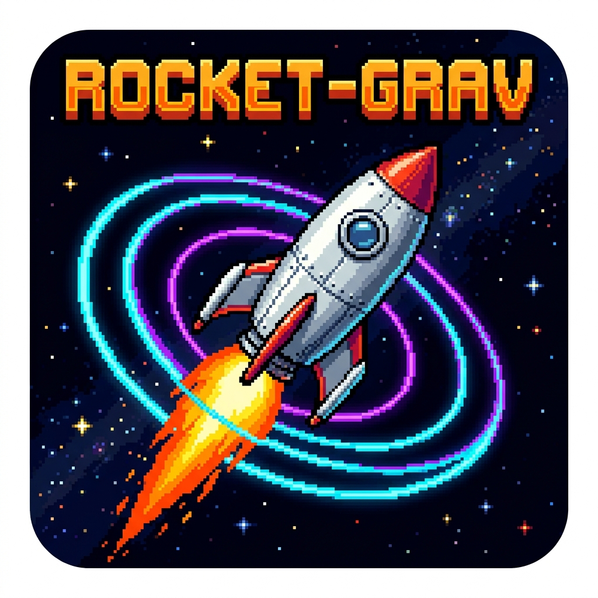
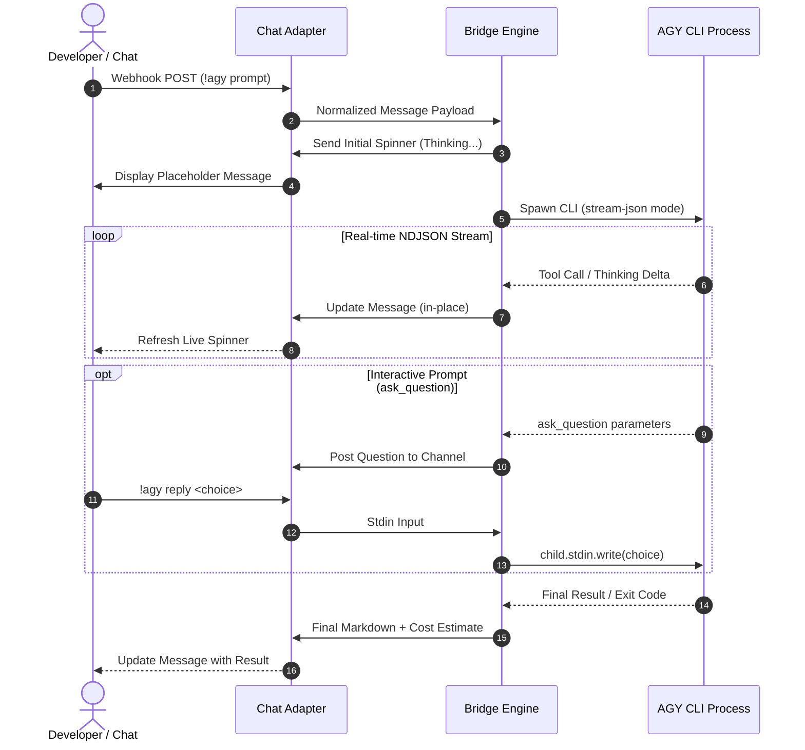

# <p align="center"></p>

```text
  ██████╗  ██████╗  ██████╗██╗  ██╗███████╗████████╗      ██████╗ ██████╗  █████╗ ██╗   ██╗
  ██╔══██╗██╔═══██╗██╔════╝██║ ██╔╝██╔════╝╚══██╔══╝     ██╔════╝ ██╔══██╗██╔══██╗██║   ██║
  ██████╔╝██║   ██║██║     █████═╝ █████╗     ██║   █████╗██║  ███╗██████╔╝███████║██║   ██║
  ██╔══██╗██║   ██║██║     ██╔═██╗ ██╔══╝     ██║   ╚════╝██║   ██║██╔══██╗██╔══██║╚██╗ ██╔╝
  ██║  ██║╚██████╔╝╚██████╗██║ ╚██╗███████╗   ██║         ╚██████╔╝██║  ██║██║  ██║ ╚████╔╝ 
  ╚═╝  ╚═╝ ╚═════╝  ╚═════╝╚═╝  ╚═╝╚══════╝   ╚═╝          ╚═════╝ ╚═╝  ╚═╝╚═╝  ╚═╝  ╚═══╝  
```

<p align="center">
  <strong>Autonomous Antigravity (AGY) Agent Bridge & Chat Gateway</strong><br />
  <em>Pluggable, real-time pair programming for Rocket.Chat, Mattermost, Slack, and beyond.</em>
</p>

<p align="center">
  
  
  
  
  
</p>

---

## [!] Motivation & Why This Was Built

The primary motivation behind building **Rocket-Grav** was to enable seamless access to the **Google Antigravity CLI (`agy`) from anywhere, on any device** (mobile phone, tablet, laptop, or remote workstation through a team chat client) while taking full advantage of an existing **Antigravity AI subscription**.

By bridging chat platforms directly to a containerized Antigravity CLI runtime:

* **Zero Per-Token API Costs:** All core reasoning, file analysis, and autonomous coding workflows utilize your flat Antigravity subscription plan rather than requiring metered commercial API keys or prepaid credits.
* **Device Independence:** Trigger complex refactors, inspect build logs, or fix bugs straight from a mobile chat app without needing terminal access or an open IDE.
* **Asynchronous Automation:** Fire off prompts into dedicated threads and receive structured notifications, live progress updates, and completion reports wherever you are.

---

## ⡷⠆ Overview

**Rocket-Grav** is a lightweight, modular gateway service connecting chat webhooks to Google's **Antigravity CLI** (`agy`). It provides an autonomous coding agent (`MangoBot`) accessible from any designated channel or thread.

### Core Capabilities

* • **Hybrid Mode & Local Ollama Offloading:** Intelligently offloads lighter questions, syntax lookups, and informational queries to a local Ollama instance (e.g. `qwen3:8b`), saving cloud quota while instantly returning results. Complex coding, refactoring, and tool execution automatically route to AGY.
* • **Model Context Protocol (MCP) Integration:** Bundled zero-dependency MCP server (`mcp/ollama-mcp.js` / `ollama-mcp`) allows Antigravity itself to query local Ollama models as sub-tools for fast summarization, translation, and reasoning tasks.
* • **Modular Chat Adapters:** Built with a pluggable adapter architecture. Switch between **Rocket.Chat**, **Mattermost**, or **Slack** with a single configuration variable (`CHAT_PROVIDER`).
* • **Live Animated Progress:** Updates messages in-place with real-time Braille status spinners (`⠋`, `⠙`, `⠹`...) and tool descriptions (`Running run_command...`, `Thinking...`).
* • **Interactive Stdin Piping:** Intercepts agent interactive questions (`ask_question`) and allows users to reply directly (`!agy reply <choice>`), piping answers into the running process.
* • **On-The-Fly Model Switching:** Switch underlying language models anytime (`!agy model switch claude`, `flash`, `gemini`, `gpt`) or Ollama models (`!agy ollama switch qwen3:8b`).
* • **Isolated Thread Sessions:** Manages multiple conversation threads and contexts independently via `threads.json`.
* • **Automatic Issue Tracking:** Automatically identifies bug/feature requests and registers them in the integrated [Beads](https://github.com/steven-tey/beads) issue tracker (`bd create`).
* • **Auto-Retry Resilience:** Automatically retries failing CLI invocations up to 3 times, surfacing complete JSON trace dumps if hard errors persist.
* • **Asset Server & Cost Tracking:** Tracks visual assets generated during runs and serves them via an embedded static HTTP gallery (`/assets`), calculating GCP API costs when external image generation APIs are invoked.

---

## ⡷⠆ Architectural Flow

Rocket-Grav uses a decoupled three-tier architecture: the **Chat Adapter Layer**, the **Core Bridge Engine**, and the **Antigravity Runtime**.

### Communication Flow

```text
 [ Team Chat ]              [ Rocket-Grav Bridge ]             [ AGY Agent Process ]
 (User in Channel)               (Express Server)                  (Container CLI)
        │                               │                                 │
  1.    │ ─── "!agy fix bug" (POST) ───►│                                 │
        │                               │ ─── 2. Quick ACK (HTTP 200) ─── │
        │◄── 3. Post '⠋ Thinking...' ──│                                 │
        │                               │ ─── 4. Spawn 'agy' process ────►│
        │                               │                                 │
        │                               │◄─── 5. Stream JSON event ───────│ (tool: read_file)
  6.    │◄── Update: '⠹ Reading...' ───│                                 │
        │                               │◄─── 7. Stream JSON event ───────│ (tool: ask_question)
  8.    │◄── Post: "Choose option:" ────│                                 │
        │                               │                                 │
  9.    │ ─── "!agy reply 1" (POST) ───►│                                 │
        │                               │ ─── 10. Pipe answer to stdin ──►│ (resumes work)
        │                               │                                 │
        │                               │◄─── 11. Process Exit (Code 0) ──│ (DONE)
 12.    │◄── Final Result / Markdown ───│                                 │
        │                               │                                 │
```

### High-Level Sequence



---

## ⡷⠆ Modular Provider Architecture

All chat integrations inherit from the base adapter interface located in `adapters/BaseAdapter.js`:

```text
adapters/
├── BaseAdapter.js           # Abstract interface for chat providers
├── RocketChatAdapter.js     # Rocket.Chat REST API & Webhook implementation
├── MattermostAdapter.js     # Mattermost Posts API implementation
├── SlackAdapter.js          # Slack Events API & Web API implementation
└── index.js                 # Dynamic factory driven by CHAT_PROVIDER
```

To switch platforms, set `CHAT_PROVIDER` in your `.env` file:

```env
CHAT_PROVIDER=rocketchat     # Options: rocketchat | mattermost | slack
```

### Platform Compatibility

| Feature | Rocket.Chat | Mattermost | Slack |
|---|:---:|:---:|:---:|
| **Inbound Webhook** | [✓] Supported | [✓] Supported | [✓] Supported |
| **In-Place Live Spinner** | `chat.update` | `PUT /api/v4/posts` | `chat.update` |
| **Interactive Stdin Reply** | `!agy reply` | `!agy reply` | `!agy reply` |
| **Thread Support** | `tmid` | `root_id` | `thread_ts` |

---

## ⡷⠆ Usage Switches & Commands

All commands can be invoked using the `!agy` prefix or `@agy` bot mention.

### 1. General Execution

| Command | Description | Example |
|---|---|---|
| `!agy <prompt>` | Sends a prompt to the agent in the active thread. | `!agy Refactor authentication in server.js` |
| `!agy help` | Shows command reference and active settings. | `!agy help` |

### 2. Issue Tracking (Beads)

Commands starting with issue keywords are automatically registered in the [Beads](https://github.com/steven-tey/beads) issue tracker (`bd create`) before execution begins:

| Command | Description | Example |
|---|---|---|
| `!agy bug <desc>` | Logs a bug under the active thread epic and runs AGY. | `!agy bug Token validation fails on empty header` |
| `!agy feature <desc>` | Logs a feature request and runs AGY. | `!agy feature Add Healthcheck route` |
| `!agy fix <desc>` | Logs a fix task and runs AGY. | `!agy fix Memory leak in event listener` |
| `!agy add <desc>` | Logs an addition task and runs AGY. | `!agy add Unit tests for adapter factory` |
| `!agy issues` / `!agy beads` | Lists all currently open issues in the workspace. | `!agy issues` |

### 3. Interactive Replies

When AGY prompts with `ask_question`:

```text
**AGY has a question:**
*Do you want to run database migrations?*
  1. Yes
  2. No
*(Reply using `!agy reply <your answer>`)*
```

| Command | Description | Example |
|---|---|---|
| `!agy reply <ans>` | Pipes answer directly to the agent process `stdin`. | `!agy reply 1` or `!agy reply yes` |
| `!agy answer <ans>` | Alias for `!agy reply`. | `!agy answer proceed` |

### 4. Model Switching

Dynamically select language models without restarting the container:

| Command | Description | Example |
|---|---|---|
| `!agy model` | Shows the currently active model. | `!agy model` |
| `!agy models` / `!agy model list` | Displays table of all available models and shortcuts. | `!agy models` |
| `!agy model switch <name>` | Switches the model used for subsequent requests. | `!agy model switch claude` |
| `!agy model use <name>` | Alias for `model switch`. | `!agy model use flash` |

#### Model Shortcuts

| Shortcut | Target Model ID | Description |
|---|---|---|
| `default` | *(none)* | Resets to default Antigravity subscription plan |
| `claude` / `opus` | `claude-opus-4-6-thinking` | Claude Opus 4.6 (Thinking enabled) |
| `sonnet` / `claude-sonnet`| `claude-sonnet-4-6` | Claude Sonnet 4.6 |
| `gemini` / `gemini-pro` | `gemini-3.1-pro-low` | Gemini 3.1 Pro (Low reasoning) |
| `gemini-pro-high` | `gemini-3.1-pro-high` | Gemini 3.1 Pro (High reasoning) |
| `flash` | `gemini-3.7-flash-medium` | Gemini 3.7 Flash (Medium reasoning) |
| `flash-high` | `gemini-3.7-flash-high` | Gemini 3.7 Flash (High reasoning) |
| `gpt` | `gpt-oss-120b-medium` | GPT-OSS 120B |
| `<custom-id>` | `<any raw model id>` | Pass any valid model string directly |

### 5. Hybrid Mode & Local Ollama MCP Integration

Rocket-Grav features an intelligent **Hybrid Mode** that allows offloading lighter task processing, code explanations, syntax lookups, and fast Q&A to a local **Ollama** server (`http://192.168.8.194:11434`), reserving Antigravity's autonomous agent engine for heavy code generation, workspace manipulation, multi-file edits, and tool runs.

#### Bridge Routing Modes

| Mode | Behavior |
|---|---|
| `HYBRID` (Default) | Smart Auto-Routing: Questions & light tasks route to local Ollama. Code edits, file creation, bash commands, tests, and beads issues route to AGY. |
| `AGY` | Classic Mode: Every prompt is routed through the Antigravity CLI agent runtime. |
| `OLLAMA` | Local-Only Mode: Prompts are answered directly by local Ollama models on LAN. |

#### Hybrid & Ollama Commands

| Command | Description | Example |
|---|---|---|
| `!agy mode` | Displays current operating mode, AGY model, and Ollama status. | `!agy mode` |
| `!agy mode <hybrid\|agy\|ollama>` | Switches the bridge operating mode on the fly. | `!agy mode hybrid` |
| `!agy ollama <prompt>` (or `!ollama`, `!ask`) | Sends prompt directly to local Ollama, bypassing AGY. | `!agy ollama explain regex lookbehind` |
| `!agy full <prompt>` | Forces execution through full AGY CLI (bypasses Ollama). | `!agy full what is this repo about?` |
| `!agy ollama list` / `!agy ollama models` | Displays all models installed on the local Ollama instance. | `!agy ollama list` |
| `!agy ollama switch <model>` | Changes the active Ollama model (e.g. `qwen3:8b`, `phi4-mini:latest`). | `!agy ollama switch phi4-mini:latest` |
| `!agy ollama ping` / `status` | Checks HTTP connection and latency to local Ollama server. | `!agy ollama ping` |

#### Antigravity MCP Server (`ollama-mcp`)

Rocket-Grav includes a bundled Model Context Protocol (MCP) server located in `mcp/ollama-mcp.js` (aliased as `ollama-mcp`). When Antigravity executes autonomous tasks, it has direct access to local Ollama models via MCP tools:

* • `ask_ollama`: Ask quick questions or offload reasoning/summarization to local models.
* • `run`: Run completions on local models (e.g., `qwen3:8b`, `phi4-mini:latest`).
* • `chat_completion`: OpenAI-compatible multi-turn chat completion.
* • `list_models`: Discovers available models on the Ollama endpoint.

**Configuration (`.gemini/config/mcp_config.json`):**
```json
{
  "mcpServers": {
    "ollama-mcp": {
      "command": "node",
      "args": [
        "/app/mcp/ollama-mcp.js",
        "--endpoint",
        "http://192.168.8.194:11434"
      ]
    }
  }
}
```

### 6. Thread & Context Management

| Command | Description | Example |
|---|---|---|
| `!agy threads` / `!agy thread list` | Lists all threads and marks the active one. | `!agy threads` |
| `!agy thread switch <name>` | Switches to an existing thread or creates a new one. | `!agy thread switch auth-refactor` |
| `!agy bind <repo>` | Binds the active thread to a Gitea repository (clones if needed). | `!agy bind rocket-grav` |
| `!agy repos` | Lists all threads and their bound repository sync status. | `!agy repos` |
| `!agy pull` | Manually pulls and rebases the active thread's bound repo from Gitea. | `!agy pull` |
| `!agy push` | Manually commits and pushes local changes to Gitea for the active thread. | `!agy push` |

### 7. Versioning, Diagnostics & Endpoints

| Command / Endpoint | Type | Description |
|---|---|---|
| `!agy version` | Chat Command | Displays installed Antigravity CLI version, latest upstream release, and auto-update status. |
| `!agy update` / `!agy upgrade` | Chat Command | Triggers an immediate check and in-place upgrade of the Antigravity CLI. |
| `!agy log` / `!agy logs` | Chat Command | Tails the last 25 lines of the active thread's `transcript.jsonl`. |
| `!agy context` / `!context` | Chat Command | Visualizes context window token usage and progress bar against the 256k limit. |
| `!agy memory` / `!agy lessons` | Chat Command | Displays recorded project (`AGENTS.md`) and global (`rules/`) lessons learned. |
| `!agy remember <lesson>` | Chat Command | Appends a persistent lesson to the active project's `AGENTS.md`. |
| `!agy remember global <lesson>` | Chat Command | Appends a system-wide guideline across all projects. |

### 8. FIFO Message Queue & Concurrency Control

When multiple prompt requests are sent in rapid succession, Rocket-Grav enqueues them in a strict First-In, First-Out (FIFO) queue. Each request waits for the preceding task to complete before executing, preventing workspace file collisions, SQLite database locks, and conversation race conditions.

| Command / Endpoint | Type | Description | Example |
|---|---|---|---|
| `!agy queue` | Chat Command | Displays currently executing task and all pending queued requests. | `!agy queue` |
| `!agy cancel` / `!agy abort` | Chat Command | Terminates the active running process and advances to next queued item. | `!agy cancel` |
| `!agy clear queue` | Chat Command | Clears all pending requests from the queue without killing the running task. | `!agy clear queue` |
| `!agy cancel all` | Chat Command | Kills the currently executing task and empties the entire pending queue. | `!agy cancel all` |
| `GET /queue` | REST Endpoint | Returns JSON payload with active job status, queued items, and rendered Markdown. | `curl http://localhost:8080/queue` |
| `POST /queue/clear` | REST Endpoint | Flushes pending queue items via HTTP. | `curl -X POST http://localhost:8080/queue/clear` |
| `POST /queue/cancel` | REST Endpoint | Aborts the active process via HTTP. | `curl -X POST http://localhost:8080/queue/cancel` |
| `GET /version` | REST API | Returns JSON payload with installed/latest version and auto-update metadata. |
| `POST /update` | REST API | Triggers on-demand Antigravity CLI update via HTTP. |
| `POST /webhook` | REST API | Inbound webhook endpoint for chat platforms or external automation scripts. |
| `GET /assets` | Web UI | Static gallery viewer for generated images and assets. |

### 9. Cross-Device Git Handoff (Laptop ⇄ Chat Bridge)

Rocket-Grav provides seamless cross-device workflow handoff. When you commit and push progress from your laptop to Gitea, you can immediately pick up where you left off via Rocket.Chat:

* • **Pre-flight Sync:** Before every AGY or Ollama prompt turn, Rocket-Grav automatically checks the repository bound to the active thread. If uncommitted changes exist, it stashes them (`git stash push -u`), fetches from Gitea (`git fetch origin`), pulls new commits from your laptop via rebase (`git pull --rebase`), and pops your stash.
* • **Conflict Alerting:** If popping a stash creates git merge conflicts, Rocket-Grav pauses execution and notifies you in chat with the conflicting files so nothing is silently overwritten.
* • **Post-Turn Auto-Push:** As soon as AGY finishes generating code or refactoring, Rocket-Grav stages all modifications (`git add -A`), creates a structured commit containing the thread name and prompt summary, and pushes back to Gitea (`git push origin <branch>`). When you return to your laptop, run `git pull` to resume locally with zero friction!

| Command / Endpoint | Type | Description | Example |
|---|---|---|---|
| `!agy bind <repo>` | Chat Command | Binds active thread to a repo (e.g. `camkerr81/my-repo` or `my-repo`). Clones if missing. | `!agy bind rocket-grav` |
| `!agy repos` | Chat Command | Displays status of all bound repositories (branch, commit, ahead/behind Gitea). | `!agy repos` |
| `!agy pull` | Chat Command | Runs pre-flight stash, fetch, and rebase pull on the active thread's repo. | `!agy pull` |
| `!agy push` | Chat Command | Stages, commits, and pushes any local changes to Gitea for the active thread. | `!agy push` |
| `GET /repos` | REST Endpoint | Returns JSON mapping of threads to repositories and their sync status. | `curl http://localhost:8080/repos` |
| `POST /repos/bind` | REST Endpoint | Dynamically binds a thread to a repository via HTTP. | `curl -X POST http://localhost:8080/repos/bind -d '{"thread":"default","repo":"rocket-grav"}'` |
| `POST /repos/sync` | REST Endpoint | Triggers manual pre-flight pull or post-turn push via HTTP. | `curl -X POST http://localhost:8080/repos/sync -d '{"action":"pull"}'` |

### 10. Local Model Handoff & Pipeline Automation

Rocket-Grav bridges the high-reasoning autonomous power of the Google Antigravity CLI with zero-token-cost local Ollama compute running on your LAN:

* • **Post-Turn Background Memory Extractor (Zero-Token Lessons):** When AGY completes a prompt turn, Rocket-Grav asynchronously passes the user prompt, git changes, and agent output to local Ollama. If a bug fix, architectural guideline, or pattern correction was made, Ollama distills a concise, actionable bullet and writes it directly to the repository's `AGENTS.md` without consuming cloud AGY tokens or slowing down chat responses.
* • **Pre-Commit Secret & Credential Scanner:** Before pushing code to Gitea, staged diffs are screened by fast heuristic patterns and local Ollama for accidentally exposed private keys, OAuth tokens, passwords, or API credentials. If a leak is detected, auto-commit is safely aborted, files are unstaged, and an alert is posted to chat.
* • **AI Conventional Commit Message Generator:** Instead of generic commit messages, local Ollama analyzes `git diff --cached --stat` and the user's prompt to draft semantic, concise conventional commit messages (e.g. `fix(auth): handle expired jwt refresh token`) in under 150ms.

---

## ⡷⠆ Docker Setup & Installation

### 1. Prerequisites

* • Docker and Docker Compose (or Portainer / Dockhand).
* • A Google account with Antigravity CLI access.
* • An active instance of Rocket.Chat, Mattermost, or Slack.
* • (Optional for Hybrid Mode) A local Ollama instance on your LAN.

### 2. Environment Variables

Configure your `.env` file according to your selected provider:

#### Common Variables

| Variable | Description | Default |
|---|---|---|
| `CHAT_PROVIDER` | Active adapter (`rocketchat`, `mattermost`, `slack`). | `rocketchat` |
| `BOT_NAME` | Bot username / alias displayed in messages. | `MangoBot` |
| `HYBRID_MODE` | Enable smart auto-routing between Ollama and AGY (`true`/`false`). | `true` |
| `AUTO_UPDATE_ENABLED` | Automatically check and update Antigravity CLI (`true`/`false`). | `true` |
| `AUTO_UPDATE_INTERVAL_HOURS` | Interval in hours between automated update checks. | `24` |
| `OLLAMA_URL` | Base URL of your local Ollama instance. | `http://192.168.8.194:11434` |
| `OLLAMA_MODEL` | Default model for local Ollama queries. | `phi4-mini:latest` |
| `GEMINI_API` | (Optional) Gemini API key for external tooling. | — |
| `GITEA_PAT` | (Optional) Personal access token for Gitea automation. | — |
| `ALLOWED_IPS` | (Optional) Comma-separated list of additional allowed client IPs/subnets. | — |

#### Rocket.Chat Provider (`CHAT_PROVIDER=rocketchat`)

| Variable | Required | Description |
|---|:---:|---|
| `ROCKETCHAT_TOKEN` | Yes | Token configured in Rocket.Chat Outgoing Webhook. |
| `ROCKETCHAT_USER_ID` | Yes | User ID of the bot account. |
| `ROCKETCHAT_PAT` | Yes | Personal Access Token (PAT) for Rocket.Chat REST API. |
| `ROCKETCHAT_URL` | Yes | Full URL of your Rocket.Chat server (e.g. `http://rocketchat.example.com:3000`). |

#### Mattermost Provider (`CHAT_PROVIDER=mattermost`)

| Variable | Required | Description |
|---|:---:|---|
| `MATTERMOST_TOKEN` | Yes | Token from Mattermost Outgoing Webhook integration. |
| `MATTERMOST_PAT` | Yes | Bot Access Token or Personal Access Token for REST API. |
| `MATTERMOST_URL` | Yes | URL of your Mattermost instance (e.g. `http://mattermost.example.com:8065`). |

#### Slack Provider (`CHAT_PROVIDER=slack`)

| Variable | Required | Description |
|---|:---:|---|
| `SLACK_BOT_TOKEN` | Yes | Bot User OAuth Token (`xoxb-...`). |
| `SLACK_VERIFICATION_TOKEN`| Yes | Verification token from Slack App settings. |

---

## ⡷⠆ Step-by-Step Walkthrough

### Step 1: Clone the Repository

```bash
git clone https://github.com/camkerr81/rocket-grav.git
cd rocket-grav
```

### Step 2: Configure `.env`

Create a `.env` file in the root directory:

```env
CHAT_PROVIDER=rocketchat
ROCKETCHAT_TOKEN=your_outgoing_webhook_token_here
ROCKETCHAT_USER_ID=your_bot_user_id_here
ROCKETCHAT_PAT=your_bot_personal_access_token_here
ROCKETCHAT_URL=http://rocketchat.example.com:3000
```

### Step 3: Start the Container

```bash
docker compose up -d --build
```

### Step 4: Perform One-Time Antigravity CLI Authentication

Before the bridge can process autonomous prompts, complete the one-time Google authentication flow inside the container:

```bash
docker exec -it rocketchat-agy-bridge agy
```

1. Click or copy the OAuth URL generated in the terminal.
2. Sign in with your Google account.
3. Once completed, your credentials are saved to `./.gemini`, persisting permanently across container restarts.

### Step 5: Configure Outgoing Webhook in Chat

1. In Rocket.Chat, go to **Administration** -> **Integrations** -> **New Integration** -> **Outgoing WebHook**.
2. Set:
   * **Event Trigger:** `Message Sent`
   * **Trigger Words:** `!agy`, `@agy`
   * **URL:** `http://<bridge-host-ip>:8080/webhook`
   * **Token:** The same token specified in `ROCKETCHAT_TOKEN`.
3. Save the integration and test by sending `!agy help` in your chat.

---

## ⡷⠆ Repository Structure

```text
rocket-grav/
├── adapters/                    # Modular chat adapter layer
│   ├── BaseAdapter.js           # Abstract adapter interface
│   ├── RocketChatAdapter.js     # Rocket.Chat adapter
│   ├── MattermostAdapter.js     # Mattermost adapter
│   ├── SlackAdapter.js          # Slack adapter
│   └── index.js                 # Adapter registry & factory
├── docs/
│   └── images/
│       └── icon.png             # 16-bit retro launcher icon
├── .gemini/                     # Persisted Antigravity session & rules (volume mounted)
├── skills/                      # Custom AGY skills folder (volume mounted)
├── workspace/                   # Target workspace where AGY reads & writes code
├── Dockerfile                   # Node.js 22 Bookworm container build definition
├── docker-compose.yml           # Compose stack definition with modular env vars
├── package.json                 # Project dependencies
├── server.js                    # Webhook listener & AGY process manager
└── README.md                    # Project documentation
```

---

## ⡷⠆ License

Internal project for autonomous development workflows with chat integrations and Google Antigravity.
All rights reserved.
